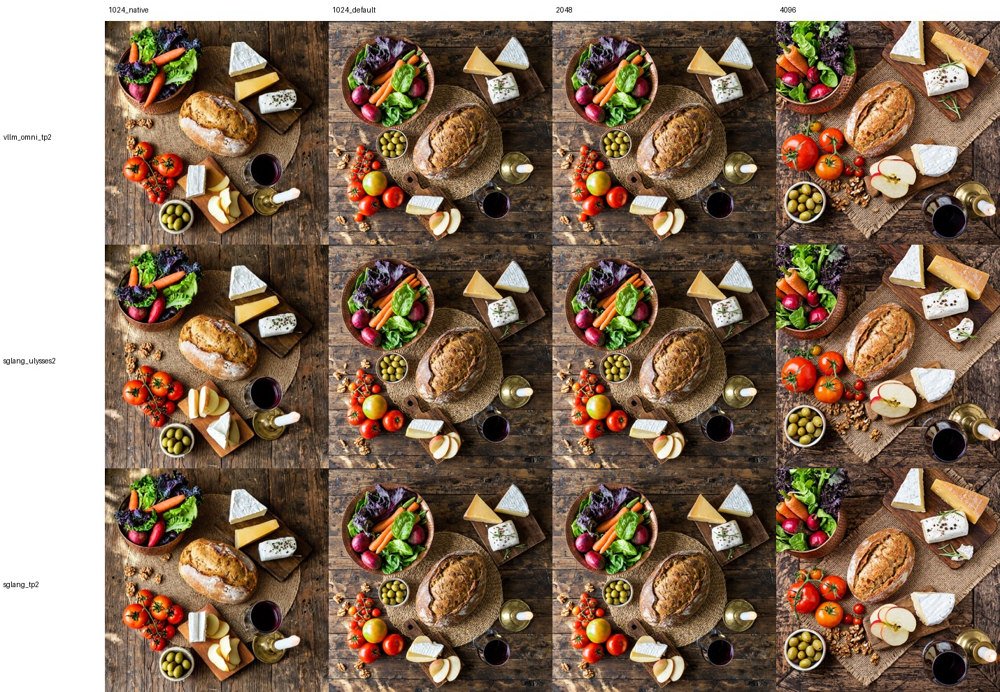

# MiniMax-H3-Image on 2× H100 80GB: vLLM-Omni vs SGLang

在 2 张 H100 80GB 上用 **vLLM-Omni** 和 **SGLang Diffusion** 部署
[MiniMaxAI/MiniMax-H3-Image](https://huggingface.co/MiniMaxAI/MiniMax-H3-Image)（text-to-image），
测 1024² / 2048² / 4096² 的单请求延迟，并对 4096² 做逐阶段耗时拆解。GPU 基线数据，用于和 Neuron 实现对比。

测试日期：2026-11-12

## TL;DR

| 分辨率（E2E 中位数） | vLLM-Omni TP2 | SGLang Ulysses2 | SGLang TP2 |
|---|---:|---:|---:|
| 1024²（真 1024 画布） | 0.57 s | **0.37 s** | **0.37 s** |
| 1024²（默认：2048 画布再缩小） | 1.38 s | **1.24 s** | 1.32 s |
| 2048² | 1.45 s | **1.19 s** | 1.28 s |
| 4096² | 6.41 s | **6.11 s** | 6.36 s |
| 每卡显存峰值 | ~58–61 GiB | ~66–68 GiB | ~47–49 GiB |

- 4096² 下 **DiT 6 步去噪占 E2E 的 ~77–80%**（每步 0.83–0.89 s），按估算约 80–85% MFU，已接近算力上限。
- 框架差异主要在 **VAE 解码**（vLLM-Omni 558 ms vs SGLang ~280 ms）和**后处理/传输链路**（vLLM-Omni ~0.32 s vs SGLang ~0.75 s 服务端部分）。
- 默认返回的是**未压缩 PNG（50.3 MB = 4096×4096×3）+ base64（67 MB JSON）**，序列化与传输合计占 0.6–1.0 s。

## 环境

| 项 | 值 |
|---|---|
| GPU | 8× H100 80GB HBM3 (SXM, NVSwitch NV18 全互联)，每个框架用 2 卡 |
| Driver | 595.112.07 (CUDA 13.2)，主机无 CUDA toolkit |
| CPU / 内存 | 2 NUMA 节点，2 TB RAM |
| vLLM-Omni | `vllm==0.33.0` + vllm-omni `ee44b9afc`（2026-11-12 main），torch 2.14.0+cu130，transformers 5.19.0 |
| SGLang | sglang `12b727d3ef`（2026-11-12 main，`python[diffusion]`），torch 2.14.1+cu130，transformers 5.19.0 |
| 模型 | `MiniMaxAI/MiniMax-H3-Image@5f90473`，text encoder `MiniMaxAI/MiniMax-H3@0919fb6`（`text_encoder/`），BF16 原生精度 |

两个服务同时运行，互不干扰：vLLM-Omni 在 GPU0,1（NUMA0），SGLang 在 GPU4,5（NUMA1），均用 `numactl` 绑核绑内存。

## 部署配置

均按官方对 H100 / 2 卡的推荐：

- **vLLM-Omni — DiT TP2，常驻**（[H100 recipe](https://github.com/vllm-project/vllm-omni/blob/main/recipes/MiniMaxAI/MiniMax-H3-Image-H100.md)）。
  Ulysses SP2 常驻需要 ~94.6 GiB/卡，80 GB 放不下；SP2+层级 offload 慢约 4×，故不测。
  ```bash
  vllm serve MiniMaxAI/MiniMax-H3-Image --omni \
    --num-gpus 2 --tensor-parallel-size 2 --usp 1 --text-encoder-tp-size 2
  ```
- **SGLang — Ulysses2 + encoder fold + 常驻 + AdaLN 预计算**（[cookbook](https://docs.sglang.io/cookbook/diffusion/MiniMax/MiniMax-H3-Image) 对 H100×2 的推荐）：
  ```bash
  sglang serve --model-path MiniMaxAI/MiniMax-H3-Image --backend sglang \
    --num-gpus 2 --tp-size 1 --ulysses-degree 2 --ring-degree 1 \
    --component-residency all=resident --encoder-parallel fold --minimax-h3-adaln-online true
  ```
- **SGLang — TP2**（同上，`--tp-size 2 --ulysses-degree 1`），用于和 vLLM-Omni 同构对比。

## 测试方法

- 官方示例 prompt（`scripts/request.t2i.json`），seed 42，`generator_device=cpu`，6 步（模型固定），无 CFG。
- `/v1/images/generations`，`response_format=b64_json`，`output_format=png`（默认，未压缩）。
- 并发 1，每个分辨率 2 次预热 + 5 次测量，取中位数。
- **关于 1024²**：模型默认 `min_generation_area = 2048²`，1024 的请求实际在 2048 画布上生成再 LANCZOS 缩小，所以耗时≈2048。
  "真 1024 画布" 一行把 `min_generation_area` 设为 1024（官方说明会影响画质）。

## 结果 1：各分辨率延迟

客户端 E2E（到收完响应体）中位数，括号内为服务端报告的推理时间：

| 分辨率 | vLLM-Omni TP2 | SGLang Ulysses2 | SGLang TP2 |
|---|---|---|---|
| 1024²（真 1024 画布） | 0.57 s（server 0.55 s） | **0.37 s**（0.34 s） | **0.37 s**（0.34 s） |
| 1024²（默认 2048 画布→缩小） | 1.38 s（1.37 s） | **1.24 s**（1.22 s） | 1.32 s（1.30 s） |
| 2048² | 1.45 s（1.38 s） | **1.19 s**（1.07 s） | 1.28 s（1.16 s） |
| 4096² | 6.41 s（6.12 s） | **6.11 s**（5.28 s） | 6.36 s（5.55 s） |

原始数据：`results/latency/*.json`。

## 结果 2：4096² 逐阶段耗时拆解

- 每次请求的 prompt 末尾加不同后缀，避免 SGLang 的 conditioning cache 命中（vLLM-Omni 无此缓存），文本编码耗时可比。
- GPU 阶段在边界处 `cuda.synchronize()`；SGLang 用内置 `perf_dump_path` + `SGLANG_DIFFUSION_SYNC_STAGE_PROFILING=1`
  （不开同步时 step 0 只计到 kernel 下发 ~44 ms，耗时被错算到后面的步）。vLLM-Omni 无分段计时，用 `patches/` 里的打点补丁。
- 所有时间戳都用 wall clock，客户端 / API 进程 / GPU worker 在同一条时间线上；各段之和与实测 E2E 一致。
- 这里的 E2E 包含客户端 JSON 解析 + base64 解码（~0.22 s），所以比结果 1 高；同步打点开销 ≤ ~0.1 s。

| 阶段 | vLLM-Omni TP2 | SGLang Ulysses2 | SGLang TP2 |
|---|---:|---:|---:|
| ① 请求接入（HTTP→API→调度→GPU worker） | 4 ms | 5 ms | 4 ms |
| ② 请求解析 + 噪声/latent 准备 | 15 ms | 7 ms | 9 ms |
| ③ 文本编码器 Qwen3-VL | 68 ms | 77 ms | 82 ms |
| ④ DiT 去噪前准备（packing/RoPE/AdaLN） | 2 ms | 6 ms | 31 ms |
| **⑤ DiT 去噪 6 步合计** | **5299 ms** | **4947 ms** | **5226 ms** |
| 　每步（step0 / step1–5 均值） | 859 / 888 ms | 797 / 830 ms | 848 / 876 ms |
| **⑥ VAE 解码（+uint8 量化、GPU→CPU）** | **587 ms** | **282 ms** | **279 ms** |
| ⑦ pipeline 其他开销 | — | 22 ms | 29 ms |
| ⑧ PNG 编码 | 166 ms（含 base64） | 249 ms | 252 ms |
| ⑨ GPU worker → API 进程 IPC | 115 ms | 185 ms | 189 ms |
| ⑩ base64 编码 | （含在⑧） | 123 ms | 121 ms |
| ⑪ JSON 序列化 + 发送 | 39 ms | 176 ms | 173 ms |
| ⑫ 客户端下载 67 MB 响应体 | 77 ms | 77 ms | 76 ms |
| ⑬ 客户端 JSON 解析 + base64 解码 | 225 ms | 221 ms | 220 ms |
| **服务端 GPU 计算（②–⑥）** | **5.97 s** | **5.32 s** | **5.63 s** |
| **E2E（到客户端拿到图片字节）** | **6.60 s** | **6.39 s** | **6.68 s** |

逐请求原始数据：`results/breakdown4096/<config>/result.json`（SGLang 另有每请求的 `sgl_perf_*.json`）。

### 分析

1. **DiT 去噪是绝对大头。** 4096² 约 16.4k 图像 token + ~300 文本 token，每步约 1.4 PFLOP（线性层 ~1.1 + 注意力 ~0.3），
   2×H100 BF16 dense 理论下限约 0.71 s/步；实测 0.83 s（SGLang Ulysses2）≈ 85% MFU，0.89 s（vLLM-Omni TP2）≈ 80%。
   进一步加速主要靠加卡（TP4/TP8）或 FP8。Ulysses2 比 TP2 每步快约 5%（TP 每层有 all-reduce）。
2. **VAE 解码 vLLM-Omni 比 SGLang 慢约 2×**（558 vs ~280 ms），是同构 TP2 下两者最大的单项差距。
3. **文本编码器很便宜**：每次换 prompt 也只要 70–80 ms。
4. **后处理/传输链路不可忽视（0.6–1.0 s）。** 默认 `output_compression=100` → PNG 压缩级别 0（未压缩），50.3 MB；
   base64 后 67 MB。vLLM-Omni 有未压缩 PNG 快速写入 + orjson，服务端这部分 ~0.32 s；SGLang 用 PIL 逐行写 PNG +
   标准 JSON，~0.75 s。客户端下载 + 解析两边相同 ~0.3 s。生产上可考虑 JPEG/WebP 或返回 URL（未实测）。
5. **TP2 同构对比**：SGLang DiT 略快（5.23 vs 5.30 s）、VAE 快 0.3 s，vLLM-Omni 后处理快 0.4 s，E2E 基本持平（6.68 vs 6.60 s）。
   SGLang Ulysses2 因 DiT 更快拿到最低的 6.39 s，但显存余量更小（~68 GiB/卡）。

## 生成图片

同 seed 下三套配置构图几乎一致（`images/comparison.jpg`）。`images/<config>/` 为全分辨率输出，
为控制仓库体积由原始 PNG 转为 JPEG q95。



## 踩坑记录

- **vLLM-Omni 的 `extra_args.min_generation_area` 在 `/v1/images/generations` 上被忽略**（recipe 文档写的是 `extra_args`），
  该接口只读 `extra_params`；传 `extra_args` 出的图与默认逐像素相同。SGLang 直接用请求顶层的 `min_generation_area`。
- **主机无 CUDA toolkit**：SGLang 导入 deep_gemm 时断言 `CUDA_HOME`，导致 `sglang serve` 识别不到 diffusion 模型、
  落到 LLM 参数解析（报 `unrecognized arguments`）。把 `CUDA_HOME` 指向 venv 里 pip 的 `nvidia/cu13` 即可。
- 同上，**还需补 `lib64 -> lib` 和 `libcudart.so -> libcudart.so.13` 软链**，否则 SGLang 的 JIT 融合 QKNorm+RoPE kernel 链接失败
  （`cannot find -lcudart`），静默回退到慢路径，测速会偏低。
- SGLang 未装 Rust 时需 `SGLANG_BUILD_RUST_EXTS=none` 安装。
- HF 下载走 Xet 时卡住（网络 0 MB/s），改 `HF_HUB_DISABLE_XET=1 HF_HUB_ENABLE_HF_TRANSFER=1` 后约 265 MB/s。

## 复现

```bash
export ROOT=$HOME/minimax-h3-image
bash scripts/setup_env.sh          # 两个 venv + CUDA_HOME 软链 + （可选）计时补丁
bash scripts/download.sh           # 权重

# 启动（默认 vLLM GPU0,1 / SGLang GPU4,5；GPUS= NUMA= PORT= 可覆盖）
bash scripts/serve_vllm.sh &
bash scripts/serve_sglang.sh &                                         # Ulysses2
# LAYOUT="--tp-size 2 --ulysses-degree 1" bash scripts/serve_sglang.sh # TP2

# 结果 1：各分辨率延迟
python scripts/bench.py --framework vllm   --url http://127.0.0.1:8000  --out out/vllm.json
python scripts/bench.py --framework sglang --url http://127.0.0.1:30000 --out out/sglang.json

# 结果 2：4096 拆解（服务端需带 H3_PROF_FILE 启动，SGLang 另加 SGLANG_DIFFUSION_SYNC_STAGE_PROFILING=1）
H3_PROF_FILE=/tmp/h3prof_vllm.jsonl bash scripts/serve_vllm.sh &
H3_PROF_FILE=/tmp/h3prof_sgl.jsonl SGLANG_DIFFUSION_SYNC_STAGE_PROFILING=1 bash scripts/serve_sglang.sh &
python scripts/profile4096.py --framework vllm   --url http://127.0.0.1:8000  --prof-file /tmp/h3prof_vllm.jsonl --out out/b_vllm/result.json
python scripts/profile4096.py --framework sglang --url http://127.0.0.1:30000 --prof-file /tmp/h3prof_sgl.jsonl  --out out/b_sgl/result.json
```

## 目录

```
scripts/   bench.py（各分辨率延迟）、profile4096.py（4096 拆解）、serve_*.sh、setup_env.sh、download.sh、request.t2i.json
patches/   vllm-omni / sglang 计时打点补丁（仅在设置 H3_PROF_FILE 时生效）
results/   latency/*.json、breakdown4096/<config>/*.json、breakdown4096/summary.md
images/    三套配置在各分辨率的输出（JPEG q95）与对比图
```
