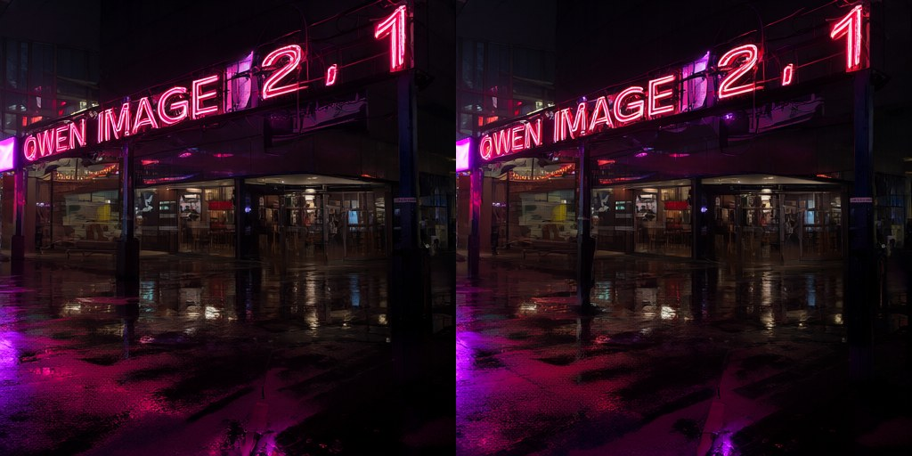
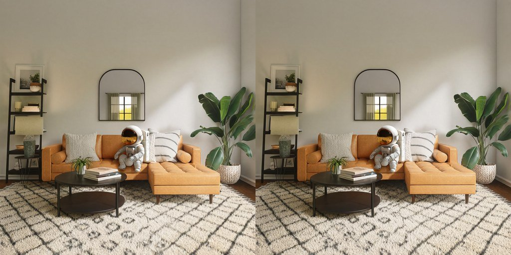
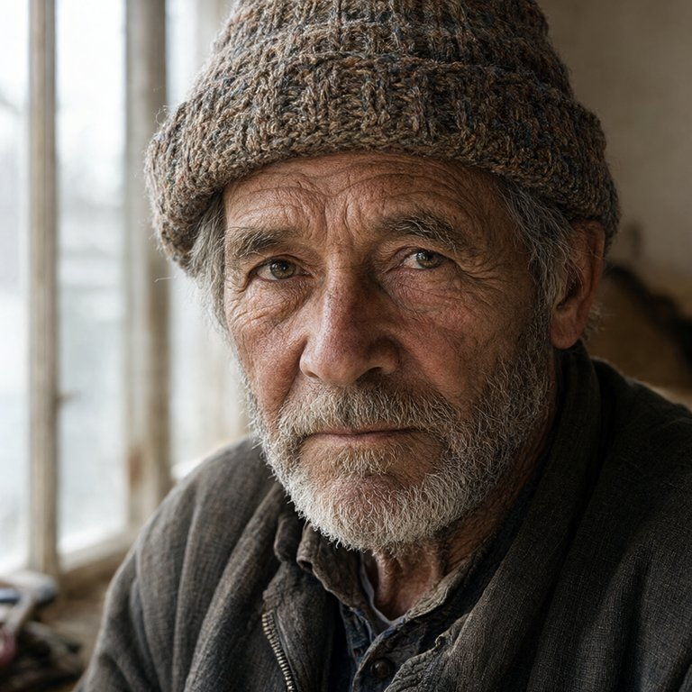
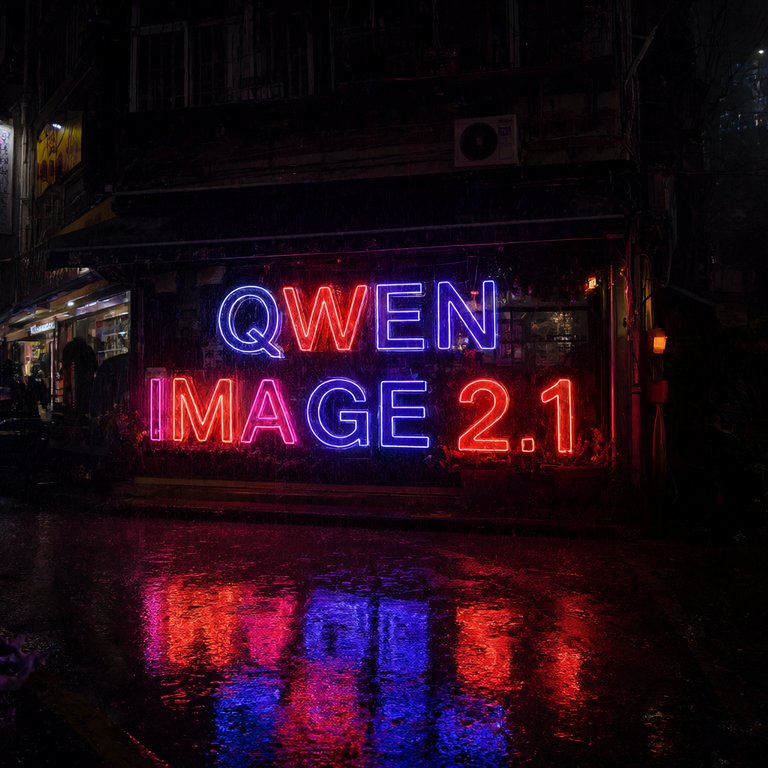
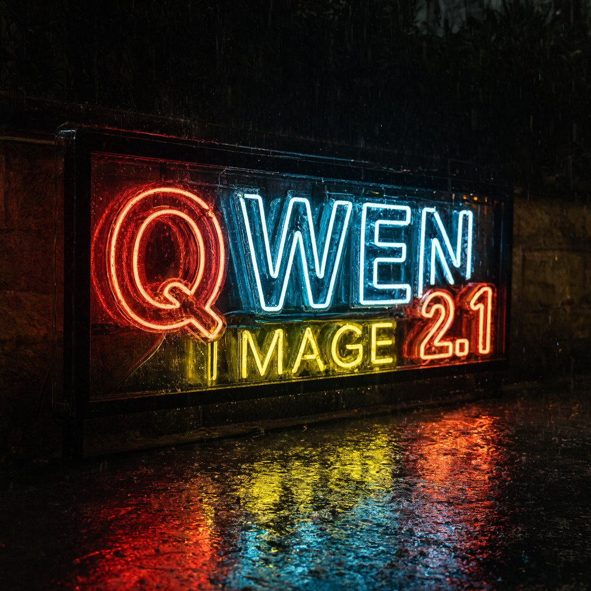
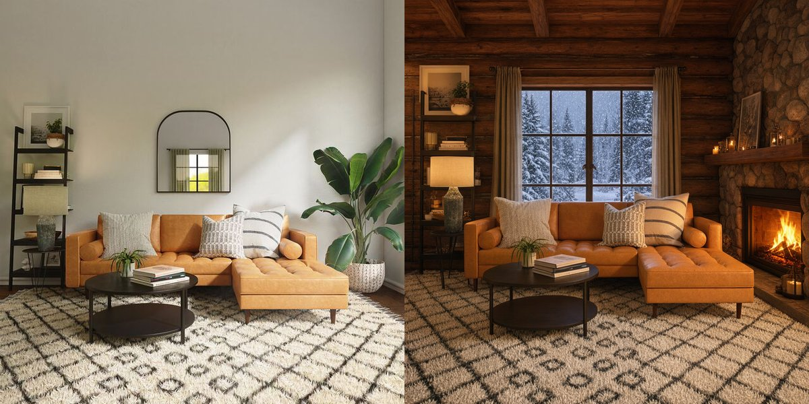
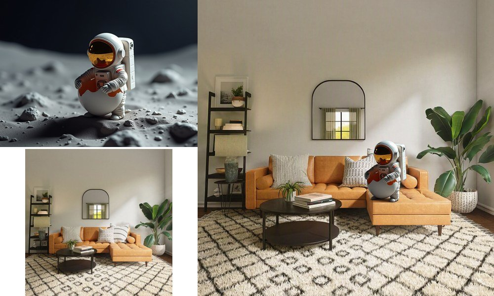
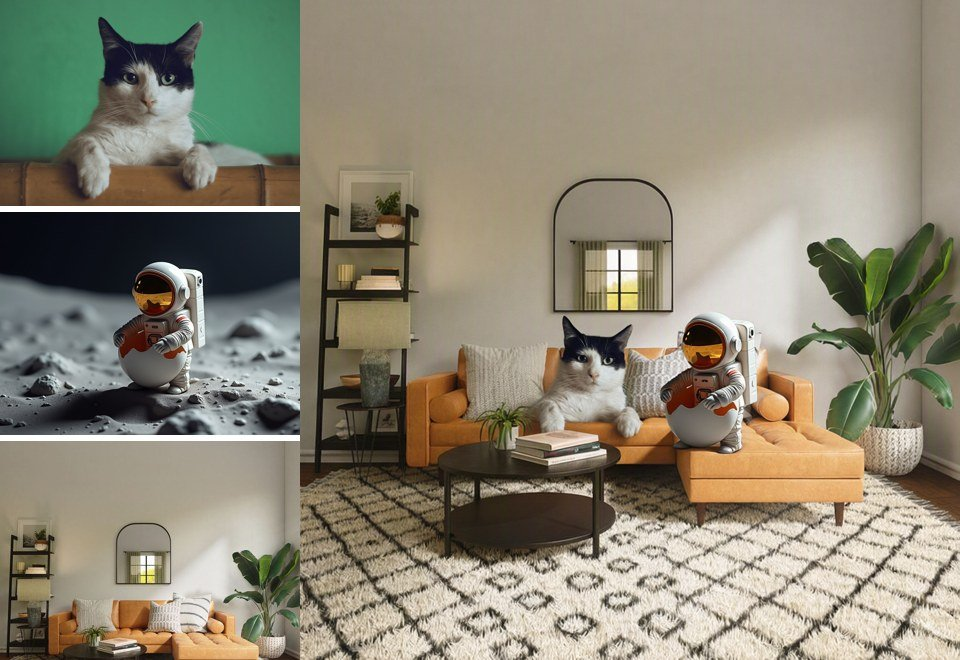

# Qwen-Image-2.1 Model Card

<!-- meta: description: Model card for Qwen-Image-2.1 text-to-image and image editing on
AWS Trainium with the vLLM Omni Neuron plugin — supported features, parallelism
configurations, latency at 1024x1024 and 2048x2048, accuracy against the diffusers
reference, sample outputs, and known limitations. -->
<!-- meta: keywords: Qwen-Image-2.1, Qwen-Image, model card, text-to-image, image editing, image generation,
diffusion, DiT, Qwen3-VL, vLLM, vLLM Omni, Neuron, Trainium, trn2, BF16, tensor parallelism,
context parallelism, sequence parallelism -->
<!-- meta: content_type: model-card -->
<!-- meta: date_updated: 2026-10-15 -->

## Introduction

[Qwen-Image-2.1](https://huggingface.co/Qwen/Qwen-Image-2.1) is a text-to-image and image
editing model from the Qwen team. Its visual generation component is a 7B-parameter,
32-layer single-stream DiT conditioned on a Qwen3-VL (8B) encoder, with a 16x spatial VAE
that produces RGBA images. The DiT attends over one joint text/image sequence with a
block-causal mask, and modulates the text tokens from `t = 0`, which makes their keys and
values independent of the denoising step.

Qwen-Image-2.1 **text-to-image** and **image editing** (up to 10 reference images) are
supported with
[vLLM Omni](https://docs.vllm.ai/projects/vllm-omni/en/latest/) using the Neuron SDK on AWS
Trainium2 (`trn2`).

**Compatible model checkpoints:**

| Model | HuggingFace | Hardware | Precision |
|-------|-------------|----------|-----------|
| Qwen-Image-2.1 | [Qwen/Qwen-Image-2.1](https://huggingface.co/Qwen/Qwen-Image-2.1) | Trn2 | BF16 |

## Features

| Category | Feature | Status |
|---|---|---|
| **Generation** | Text-to-image | ✅ |
| | 512x512 to 2048x2048 (multiples of 32) | ✅ |
| | Image editing (one condition image) | ✅ |
| | Multi-image reference editing (up to 10 images) | ✅ |
| | Masks, region marks | ❌ |
| | Classifier-free guidance | ❌ (the model is sampled without it) |
| **Precision** | BF16 | ✅ |
| **Parallelism** | Tensor parallelism (TP) | ✅ |
| | Megatron sequence parallelism (SP, within TP) | ✅ (on by default) |
| | Context parallelism (CP, `ring_degree`) | ✅ |
| | Parallel tiled VAE decode | ✅ (above 1024x1024) |
| **Compilation** | torch.compile | ✅ |
| **Serving** | Batch size | 1 |

## How it runs

Per text-to-image request the pipeline runs four kinds of compiled graphs:

1. **Text encoder** — the Qwen3-VL language model (TP-sharded), at a static prompt length
   (`max_text_tokens`, default 512 tokens after the system prompt).
2. **DiT prefix** — once per request, the text tokens pass through the 32 blocks and every
   block's text K/V is kept (the reference pipeline's prefix KV cache).
3. **DiT step** — every denoising step runs the image tokens only, attending to
   `[image K/V, cached text K/V]`, and applies the flow-matching Euler update in-graph, so
   the latents stay on device for the whole loop.
4. **VAE decoder** — compiled per stage. Above a 64x64 latent (1024x1024 pixels) the
   up-sampling stages decode as exact overlapping tiles spread over all ranks.

An edit request (one or more condition images in `multi_modal_data["image"]`) changes the
first two steps, as in the reference pipeline:

- Each condition image is resized to the area of `edit_resolution`² (default 1024²) at
  its own aspect ratio; by default the output takes the last image's size. The prompt
  refers to the images as image 1, image 2, ... (the edit chat template carries one
  `<imageN>` placeholder per image).
- The **Qwen3-VL vision tower** (TP-sharded, compiled) encodes each image (alpha
  composited over white) on its own. Its tokens replace the image's placeholder, its
  DeepStack features are added to the first language-model layers, and the language model
  uses Qwen3-VL's 3-D MRoPE positions.
- The **VAE encoder** (compiled per stage) turns each image (all four RGBA channels) into
  a latent block that takes the place of its image slots in the DiT prefix. The prefix
  attention is causal over text and bidirectional inside each image block.

The DiT projections use the fused NKI QKV kernel (projection, per-head RMS QK-norm and RoPE
in one kernel, head-major output) and the fused AdaLN kernel, with sequence parallelism
over the TP group.

## Running

```bash
# 1024x1024, 40 steps, TP=8 (examples/qwen_image_2_1/qwen_image_2_1_stage.yaml)
python examples/qwen_image_2_1/run.py --prompt "A neon shop sign ..." --output out.png

# Other configurations
python examples/qwen_image_2_1/run.py --tensor-parallel-size 16 --height 2048 --width 2048
python examples/qwen_image_2_1/run.py --tensor-parallel-size 4 --context-parallel-size 2

# Warm latency: time 3 requests after the first (compiling) one
python examples/qwen_image_2_1/run.py --profile --profile-runs 3

# Image editing: the output size follows the input image's aspect ratio
python examples/qwen_image_2_1/run.py --image cat.png \
  --prompt "Put a red wizard hat on the cat and change the background to a starry night sky"

# Multi-image reference editing: the output size follows the last image
python examples/qwen_image_2_1/run.py --image astronaut.jpg livingroom.png \
  --prompt "Place the astronaut from image 1 sitting on the orange sofa in the living room from image 2"
```

With the `Omni` API, pass the condition image (or a list of images) in the prompt:

```python
from PIL import Image
omni.generate(
    {"prompt": "Make it snow", "multi_modal_data": {"image": Image.open("in.png")}},
    OmniDiffusionSamplingParams(num_inference_steps=40, seed=42),
)
```

The first request compiles the graphs for the requested resolution and parallel layout:
roughly 4–5 minutes at 1024x1024 and 15–25 minutes at 2048x2048. An edit compiles
graphs per condition-image size as well (about 6–20 minutes the first time a size is
seen). Later runs load the compiled graphs from the cache.

## Performance

Measured on one `trn2.48xlarge` (Neuron SDK 2.32, `NEURON_LOGICAL_NC_CONFIG=2`), BF16,
40 steps, batch size 1. Latency is the warm end-to-end time of `omni.generate` (text
encoding, denoising, VAE decode and post-processing), averaged over the profiled runs.

**1024x1024**

| Configuration | NeuronCores | End-to-end | Denoise (per step) | VAE decode |
|---|---|---|---|---|
| TP=4 | 4 | 10.64 s | 10.11 s (253 ms) | 0.51 s |
| TP=8 | 8 | 5.88 s | 5.36 s (134 ms) | 0.46 s |
| TP=16 | 16 | 3.89 s | 3.33 s (83 ms) | 0.46 s |

**2048x2048**

| Configuration | NeuronCores | End-to-end | Denoise (per step) | VAE decode |
|---|---|---|---|---|
| TP=4 | 4 | 64.3 s | 63.8 s (1.59 s) | 3.10 s |
| TP=8 | 8 | 30.8 s | 29.7 s (743 ms) | 1.31 s |
| TP=4 × CP=2 | 8 | 32.1 s | 30.8 s (770 ms) | 1.30 s |
| TP=16 | 16 | 16.0 s | 15.0 s (376 ms) | 0.74 s |

At 512x512 with 20 steps, TP=8 generates an image in 0.95 s.

Latency scales close to linearly with the core count, so per-core throughput is similar
across these layouts; TP=8 is slightly faster than TP=4 × CP=2 on the same 8 cores. For the
lowest latency use TP=16; for throughput, run several smaller replicas (for example TP=4)
on separate cores.

**Image editing** (TP=8, `edit_resolution=1024`, 40 steps). The output size follows the
condition image; "prefix" is the vision tower, language model, VAE encoder and DiT prefix.

| Input image | Output | End-to-end | Denoise (per step) | Prefix |
|---|---|---|---|---|
| 1024x704 (cat) | 1248x864 | 7.63 s | 6.48 s (162 ms) | 0.65 s |
| 1184x880 (astronaut) | 1184x896 | 7.70 s | 6.43 s (161 ms) | 0.73 s |
| 640x640 (living room) | 1024x1024 | 7.51 s | 6.25 s (156 ms) | 0.76 s |
| 2 images (astronaut, living room) | 1024x1024 | 8.83 s | 6.98 s (175 ms) | 1.34 s |
| 3 images (cat, astronaut, living room) | 1024x1024 | 10.39 s | 7.77 s (194 ms) | 2.11 s |

Editing costs more per step than text-to-image at the same size because the target
attends to the condition images' latent tokens as well as the text; each extra reference
image adds its vision-tower and VAE-encoder pass to the prefix and its tokens to every
step's attention.

## Accuracy

**Component level** (CPU, FP32, TP=1 and CP=2) against the diffusers reference
(`QwenImage21Pipeline`, huggingface/diffusers@916a5791): the text encoder, the first-step
DiT noise prediction and the VAE decode match with a relative L2 error of about 1e-6.

**End to end on Neuron.** With the same seed, the Neuron pipeline starts from the same
noise as the diffusers pipeline in BF16. At 512x512 and 20 steps the Neuron output
matches the CPU BF16 diffusers output with:

| Configuration | PSNR | SSIM |
|---|---|---|
| TP=8 | 27.5 dB | 0.939 |
| TP=4 | 28.5 dB | 0.949 |
| TP=4 × CP=2 | 27.7 dB | 0.943 |

Two BF16 implementations do not match bit for bit: rounding differences compound over the
denoising steps (the diffusers documentation notes the same when toggling its KV cache).



*Neuron TP=8 (left) and the CPU BF16 diffusers reference (right): 512x512, 20 steps,
seed 42.*

**Image editing.** On CPU in FP32, the vision tower matches the transformers model with a
relative L2 error of 2e-5 and the first-step DiT noise prediction of an edit matches the
diffusers reference with 2e-6 (TP=1 and TP=8). On Neuron (TP=8), editing the cat image
below at `edit_resolution=512` (416x608 output, 20 steps) matches the CPU BF16 diffusers
output with **PSNR 34.8 dB, SSIM 0.967**.


*Edit "Put a red wizard hat on the cat and change the background to a starry night sky":
Neuron TP=8 (left) and the CPU BF16 diffusers reference (right), 416x608, 20 steps, seed 42.*

**Multi-image editing.** With two reference images (astronaut, living room), the
first-step DiT noise prediction matches the diffusers reference with a relative L2 error
of 2e-6 on CPU, and the Neuron output (TP=8, `edit_resolution=512`, 20 steps) matches the
CPU BF16 diffusers output with **PSNR 28.2 dB, SSIM 0.934**.



*"Place the astronaut from image 1 sitting on the orange sofa in the living room from
image 2": Neuron TP=8 (left) and the CPU BF16 diffusers reference (right), 512x512, 20
steps, seed 42.*

## Sample outputs

Generated on Neuron (TP=8, 1024x1024, 40 steps, seed 42), downscaled for this page.

| | |
|---|---|
|  |  |
| *A close-up portrait of an elderly fisherman with a weathered face and a knitted wool cap, soft window light, 85mm photograph, highly detailed skin texture* | *A misty alpine lake at sunrise, pine forests and snow-capped peaks reflected in still water, golden light, wide-angle landscape photograph* |
|  |  |
| *一张中国风海报，宣纸纹理背景，中间用毛笔书法写着“春风十里”四个大字，左下角有一枝盛开的梅花，右上角有红色印章* | *A cozy isometric illustration of a tiny bookstore cafe on a rainy evening, warm lights inside, a cat sleeping on a windowsill, soft pastel colors* |
|  |  |
| *A neon shop sign that reads "QWEN IMAGE 2.1", rainy night, reflections on wet pavement* (1024x1024, TP=8) | Same prompt at 2048x2048 (TP=4 × CP=2) |

### Image editing

Input (left) and Neuron output (right), TP=8, `edit_resolution=1024`, 40 steps, seed 42.
Input images are from the
[huggingface/documentation-images](https://huggingface.co/datasets/huggingface/documentation-images)
dataset (`diffusers/cat.png`, `diffusers/astronaut.jpg`, `diffusers/gligen/livingroom_modern.png`).


*Put a red wizard hat on the cat and change the background to a starry night sky*


*Replace the green background with a dark brick wall with a pink neon sign that reads "HELLO NEURON"*


*Change the scene to an underwater coral reef with colorful fish, keep the astronaut*



*Turn this living room into a cozy winter cabin with a lit fireplace and snow falling outside the window*

### Multi-image reference editing

Reference images (left, image 1 on top) and Neuron output (right), TP=8,
`edit_resolution=1024`, 40 steps, seed 42.



*Place the astronaut from image 1 sitting on the orange sofa in the living room from image 2*



*The cat from image 1 and the astronaut from image 2 sitting together on the orange sofa in the living room from image 3*

## Known limitations

- **No masks or region marks.** Edits take up to 10 whole reference images; masks and
  drawn region marks are not implemented.
- **New sizes compile.** Each output size, and for edits each condition-image size, adds
  compiled graphs on first use.
- **No classifier-free guidance.** `true_cfg_scale` and negative prompts are ignored.
- **Batch size is one** prompt and one image per request.
- **Prompt length is static.** Prompts longer than `model_config.max_text_tokens` (default
  512 tokens, not counting the condition image) are rejected; raise it in the stage config
  (this recompiles).
- **Context parallelism** needs the latent token count, `(H/16) * (W/16)`, to divide by
  the CP degree.
- **Fused QKV kernel width.** On this SDK the fused NKI QKV kernel returns wrong results
  above a 1536-wide output (more than 4 heads per rank), so ranks holding 8 heads (TP=4)
  project in two head groups.
